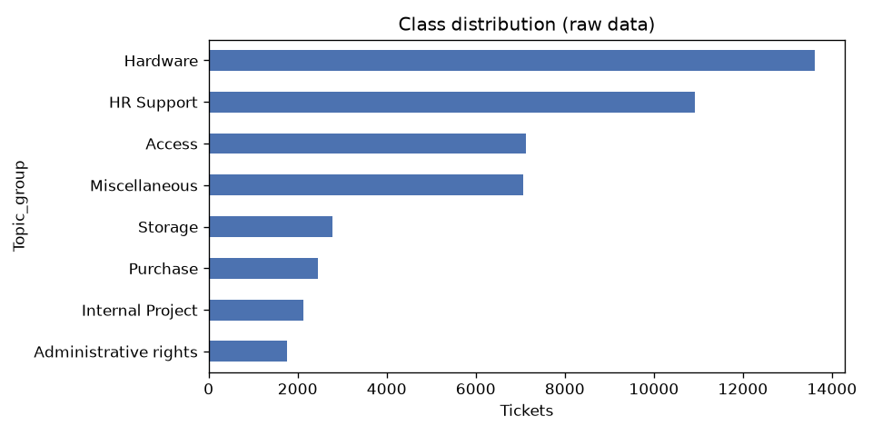
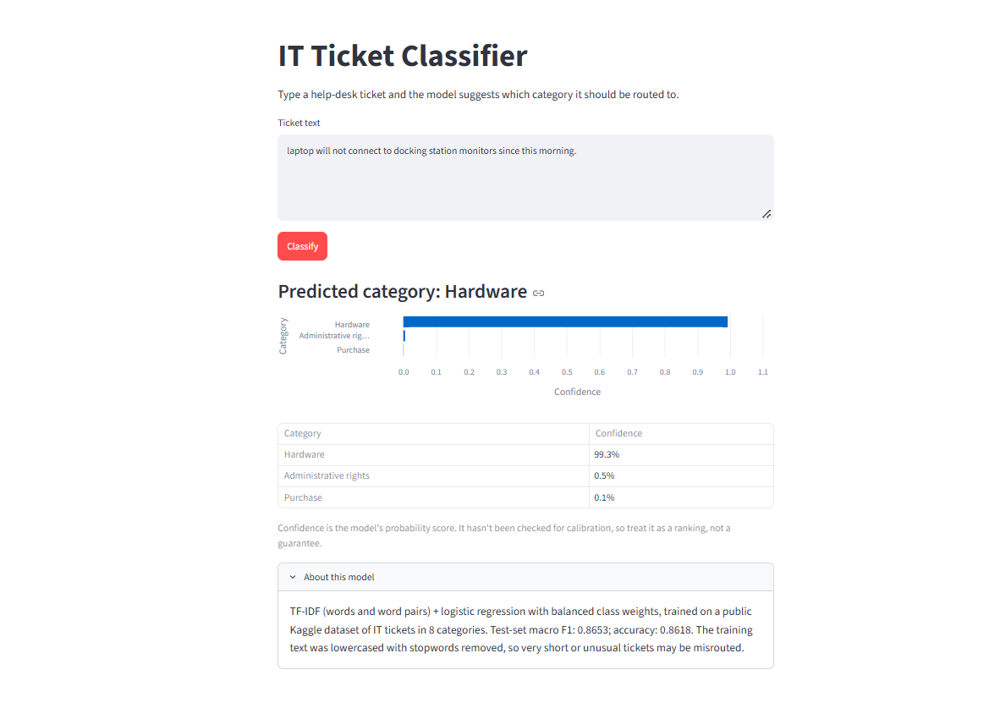

# IT Support Ticket Classifier

Routes help-desk tickets to the right category from the ticket text alone, using TF-IDF and logistic regression. It trains on a normal laptop CPU in a few minutes and includes a Streamlit demo app.

| | |
|---|---|
| Tickets | 47,837 (8 categories) |
| Final model | TF-IDF (words + word pairs) + logistic regression, balanced class weights |
| **Test macro F1** | **0.8653** (accuracy 0.8618) |
| Simple baseline (default TF-IDF + LogReg), test macro F1 | 0.8504 |
| Majority-class baseline, test macro F1 | 0.0564 (accuracy 0.2910) |

## The question

**Can ticket text alone route help-desk tickets to the right category accurately enough to be useful, and how much does a stronger model beat a simple baseline?**

I work in IT support, and this is the tool I wished our help desk had.

**Short answer.** Yes, within the limits of this dataset. The final model routes 86% of held-out tickets correctly, and every category has recall of at least 0.84. A plain TF-IDF + logistic regression baseline already gets most of the way (macro F1 0.8504). Tuning, word pairs and class weights add **+0.0149 macro F1** (0.8653 − 0.8504). The gain is modest overall and largest on the smallest categories. See [Limitations](#limitations) for what "useful" doesn't cover.

## Dataset

- **Source:** [IT Service Ticket Classification Dataset](https://www.kaggle.com/datasets/adisongoh/it-service-ticket-classification-dataset) by Adison Goh, on Kaggle
- **License:** CC0, public domain
- **File:** `all_tickets_processed_improved_v3.csv`, two columns: `Document` (ticket text) and `Topic_group` (category)
- **Text is pre-processed upstream:** it's lowercased, with punctuation, digits and many stopwords already removed. A typical row: `reset passwords for external accounts re expire days hi ask help update passwords colleagues thank...`

### Profiling ([`reports/data_profile.md`](reports/data_profile.md))

- 47,837 rows; no missing or blank text, no missing labels
- Ticket length: median 26 words; middle 50% between 17 and 46 words; maximum 981 words
- **0 exact duplicates**, but **7,209 tickets (15%) form 1,638 near-duplicate clusters** (TF-IDF cosine ≥ 0.9). These are templated tickets: leaver forms, new-starter forms, purchase-order emails. The largest cluster is 638 purchase-order emails.
- No columns beyond text and label, so no column can leak the label
- **Personal info:** 0 email addresses, 0 phone numbers, 0 URLs, 0 IP addresses, and no digits anywhere. Names appear to have been replaced with job titles upstream ("hi analyst"), but a spot check of 64 common first names found 2 that survived ("ion", "florin") in 91 tickets. These are masked in cleaning.

### Cleaning ([`reports/cleaning_report.md`](reports/cleaning_report.md))

| Step | Rows after | Effect |
|---|---:|---|
| Raw rows | 47,837 | |
| 1. Normalise whitespace | 47,837 | 174 texts changed |
| 2. Drop empty text | 47,837 | 0 rows dropped |
| 3. Drop exact duplicates (and texts with conflicting labels) | 47,837 | 0 rows dropped |
| 4. Mask first names with `<name>` | 47,837 | 91 texts changed |
| 5. Merge classes under 100 rows into "Other" | 47,837 | 0 labels changed |
| 6. Assign near-duplicate groups | 47,837 | 42,261 groups; 7,215 rows in 1,639 multi-ticket clusters |

**47,837 rows before cleaning, 47,837 after.** No rule needed to drop anything. Short tickets (as few as 2 words) are kept on purpose, because "printer broken" is a real ticket.

### Class distribution



| Category | Tickets | % |
|---|---:|---:|
| Hardware | 13,617 | 28.47 |
| HR Support | 10,915 | 22.82 |
| Access | 7,125 | 14.89 |
| Miscellaneous | 7,060 | 14.76 |
| Storage | 2,777 | 5.81 |
| Purchase | 2,464 | 5.15 |
| Internal Project | 2,119 | 4.43 |
| Administrative rights | 1,760 | 3.68 |

The largest class is 7.7× the smallest. The imbalance is real but no class is rare, so nothing was merged or dropped.

## Methods

### 1. Split: stratified and group-aware ([`reports/split_report.md`](reports/split_report.md))

| Split | Rows | % |
|---|---:|---:|
| Train | 33,920 | 70.9 |
| Validation | 6,958 | 14.5 |
| Test | 6,959 | 14.5 |

- **Near-duplicates never cross splits.** Each near-duplicate cluster stays entirely inside one split, so the model can't score well on test just by having trained on a near-copy of a test ticket.
- **Large templates go to training.** The 10 clusters with 50 or more tickets (1,441 rows) are recurring templates you'd always have history for in production. Left free, a single 638-ticket template would have dominated whichever evaluation split it landed in.
- **The rest uses `StratifiedGroupKFold`** (20 folds, dealt 14 / 3 / 3 to train / val / test, seeded at random). Stratification keeps the class mix close across splits. The split report checks that no group or identical text is shared between splits.

### 2. Models

Every model with a feature step is a single scikit-learn `Pipeline`, so TF-IDF is fit only on training text and never sees validation or test data. Tuning used `GridSearchCV` with 5-fold `StratifiedGroupKFold` **on the training set only**, scored by macro F1. The tuned models were then compared on validation. The test set was used once, at the end, on the single chosen model ([`src/evaluate_test.py`](src/evaluate_test.py) refuses to run a second time).

**Why macro F1 is the headline metric.** Macro F1 averages the per-class F1 scores equally, so small categories like Administrative rights count as much as Hardware. Accuracy can look decent while a model ignores small classes. The majority baseline gets 29% accuracy but only 0.056 macro F1.

| Model | What's different |
|---|---|
| Majority class | Always predicts "Hardware" |
| TF-IDF + LogReg (default) | Single words, default settings |
| TF-IDF + LogReg (tuned) | Tuned: C, word n-gram range, class weights; sublinear TF |
| TF-IDF + LinearSVC (tuned) | Same grid with a linear SVM |
| Word + char n-grams + LinearSVC (tuned) | Adds character 2–5-grams |

## Results

### Validation (model selection) ([`reports/model_selection.md`](reports/model_selection.md))

| Model | CV macro F1 (train, 5-fold) | Val accuracy | Val macro F1 | Val weighted F1 |
|---|---:|---:|---:|---:|
| **TF-IDF + LogReg (tuned)** | 0.8586 ± 0.0053 | 0.8594 | **0.8616** | 0.8597 |
| Word + char n-grams + LinearSVC (tuned) | 0.8540 ± 0.0093 | 0.8571 | 0.8571 | 0.8574 |
| TF-IDF + LinearSVC (tuned) | 0.8562 ± 0.0058 | 0.8560 | 0.8548 | 0.8563 |
| TF-IDF + LogReg (default) | 0.8429 ± 0.0059 | 0.8525 | 0.8470 | 0.8524 |
| Majority class | 0.0550 ± 0.0008 | 0.2910 | 0.0564 | 0.1312 |

Best settings: `C=20`, `class_weight="balanced"`, `ngram_range=(1, 2)`. The C=20 sits at the top edge of the grid, so a wider search might find slightly more. Every tuned model chose balanced class weights and word bigrams. Character n-grams didn't help, which is plausible since the text was already normalised upstream.

### Test (single evaluation) ([`reports/test_results.md`](reports/test_results.md))

| Model | Accuracy | Macro P | Macro R | **Macro F1** | Weighted F1 |
|---|---:|---:|---:|---:|---:|
| **TF-IDF + LogReg (tuned), final** | 0.8618 | 0.8685 | 0.8633 | **0.8653** | 0.8622 |
| TF-IDF + LogReg (default) | 0.8484 | 0.8895 | 0.8196 | 0.8504 | 0.8487 |
| Majority class | 0.2910 | 0.0364 | 0.1250 | 0.0564 | 0.1312 |

The final model was chosen on validation before test was touched. The baselines' test scores are shown for comparison only. Validation macro F1 (0.8616) and test macro F1 (0.8653) agree closely, which is what you'd expect with no leakage between splits.

**Per category (final model, test set):**

| Category | Precision | Recall | F1 | Tickets |
|---|---:|---:|---:|---:|
| Hardware | 0.8485 | 0.8632 | 0.8558 | 2,025 |
| HR Support | 0.8735 | 0.8607 | 0.8670 | 1,572 |
| Access | 0.9252 | 0.8519 | 0.8870 | 1,060 |
| Miscellaneous | 0.7975 | 0.8580 | 0.8266 | 1,056 |
| Storage | 0.9227 | 0.8937 | 0.9080 | 414 |
| Internal Project | 0.8520 | 0.8868 | 0.8690 | 318 |
| Administrative rights | 0.8116 | 0.8485 | 0.8296 | 264 |
| Purchase | 0.9174 | 0.8440 | 0.8792 | 250 |

### Confusion matrix


The most common errors are HR Support → Hardware (107), Hardware → Miscellaneous (106) and Hardware → HR Support (76). Hardware acts as the fallback when the model is unsure: 11% of Administrative-rights tickets are predicted as Hardware.

### Error analysis

[`reports/test_results.md`](reports/test_results.md) lists 15 misclassified test tickets, a seeded random sample of the 962 errors, and [`reports/misclassified_notes.md`](reports/misclassified_notes.md) has my notes on each. In about 5 of the 15 the label itself looks wrong or arbitrary to a human reader. Others sit on genuinely overlapping boundaries, like a "new starter access card", which could be HR Support or Access.

## Demo app



Type a ticket and the app shows the predicted category and the top 3 categories with confidence scores.

```powershell
.venv\Scripts\streamlit.exe run app.py
```

Then open http://localhost:8501. The app needs `models/ticket_classifier.joblib`, which is created by step 5 of [How to reproduce](#how-to-reproduce).

## Limitations

- **A public dataset, not your help desk.** The tickets come from one organisation's history, and its category scheme reflects how that organisation routed work. A different help desk would need its own labelled tickets and a retrain. The test score measures how well the model copies *this* dataset's labelling, not how well it would route your tickets.
- **No "Software" category, so software problems go to Hardware.** In training, 88% of tickets containing "frozen", 87% with "freezing" and 75% with "crashing" are labelled Hardware. The model learned that, so "Google Chrome keeps freezing and crashing" comes out as Hardware (0.55). See [`reports/probe_examples.md`](reports/probe_examples.md).
- **Company-specific quirks.** 76% of training tickets mentioning "outlook" are labelled Administrative rights, so "outlook is not opening" comes out as Administrative rights with confidence 1.00. That's this organisation's routing habit, and it wouldn't carry over to another help desk.
- **Unknown words are ignored.** "google" never appears in the training data. Tickets about products the model has never seen are routed on their remaining words alone.
- **Vague tickets fall back to Hardware.** With no recognised words, the model predicts Hardware, the largest class with the highest intercept. Short vague tickets like "google app is frozen" end up as near ties (Administrative rights 0.37, Hardware 0.37). The app still shows the top category as the answer, so a borderline guess can look like a confident verdict.
- **Mixed requests go to the more common category.** "Please grant me admin rights … to install Visual Studio" → Access (Administrative rights scored 0.07). "Order 5 new keyboards … PO attached" → Hardware (Purchase scored 0.05).
- **The labels are noisy.** In my reading of 15 random test errors, about 5 had labels that look wrong. Label noise caps how high any model can score, and some test "errors" may actually be correct predictions.
- **Different text from live tickets.** The training text was lowercased with stopwords removed upstream, and the original raw tickets aren't available. The app applies only light cleaning to typed input. Unseen words, including normal stopwords, are simply ignored, but live tickets with signatures, quoted email threads or other languages could behave differently.
- **Confidence isn't calibrated.** The app shows logistic-regression probabilities without checking whether 0.8 really means right 80% of the time.
- **Imbalance.** Even with class weights, the small categories have the least data. Purchase and Administrative rights each have only 250–264 test tickets, so their per-class scores are less precise than those of the big classes.
- **The test score is probably a little conservative for templates.** Large recurring templates were put in training on purpose, so the evaluation splits contain the more varied tickets. For example, Purchase makes up 3.59% of validation and test against 5.79% of train.
- **Not tested:** other languages, very long email threads beyond what's in the data, or how the model performs over time as ticket topics change.

## How to reproduce

Requires Python 3.13 on Windows (CPU only, no GPU or paid APIs). All randomness uses one seed: `RANDOM_SEED = 42` in [`src/config.py`](src/config.py).

**1. Set up**
```powershell
cd "C:\IT Ticket Classifier"
python -m venv .venv
.venv\Scripts\Activate.ps1
pip install -r requirements.txt
```
If activation fails with *"running scripts is disabled on this system"*, either run `Set-ExecutionPolicy -Scope CurrentUser RemoteSigned` once, or skip activation and call the venv's programs directly: `.venv\Scripts\python.exe` and `.venv\Scripts\streamlit.exe`.

**2. Get the data:** download `all_tickets_processed_improved_v3.csv` from the [Kaggle page](https://www.kaggle.com/datasets/adisongoh/it-service-ticket-classification-dataset) into `data/raw/`.

**3. Run the pipeline in order:**

| Command | What it does | Time on my laptop |
|---|---|---|
| `python -m src.profile_data` | Profiles the raw data → `reports/data_profile.md` | ~2.5 min |
| `python -m src.clean_data` | Cleans and assigns groups → `data/processed/tickets_clean.csv` | ~2 min |
| `python -m src.split_data` | Train / val / test split → `data/processed/*.csv` | ~1 min |
| `python -m src.train_baselines` | Two baselines on validation | ~15 s |
| `python -m src.train_models` | Tunes all candidates with CV, scores on validation | ~22 min |
| `python -m src.evaluate_test` | **One-time** test evaluation, saves `models/ticket_classifier.joblib` | ~15 s |
| `python -m src.probe_examples` | Hand-written spot checks → `reports/probe_examples.md` | ~5 s |

**4. Run the tests:** `pytest` (24 tests: cleaning, splitting, scoring, prediction).

**5. Launch the app:** `streamlit run app.py`.

## Project layout

```
app.py                  Streamlit demo
src/config.py           seed and paths
src/profile_data.py     data profiling and personal-info scan
src/dedup.py            near-duplicate detection and clustering
src/clean_data.py       cleaning rules
src/split_data.py       stratified, group-aware train/val/test split
src/evaluate.py         shared metrics and results table
src/train_baselines.py  majority + default TF-IDF/LogReg
src/train_models.py     tuned candidates with cross-validation
src/evaluate_test.py    single test-set evaluation and final model
src/predict.py          load model and classify one ticket
src/probe_examples.py   hand-written spot checks for the limitations
tests/                  pytest tests
reports/                reports and figures (generated by the scripts above)
data/, models/          git-ignored (data files and trained models)
```

## License

The code is released under the [MIT License](LICENSE). The dataset is not included in this repository; it is published separately on Kaggle under CC0 (public domain).
