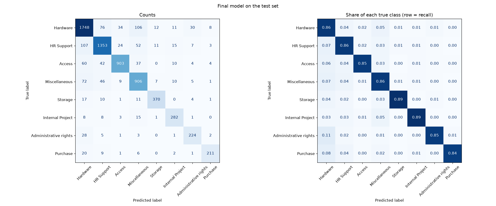

# Test set results (single evaluation)

Final model: **TF-IDF + LogReg (tuned)**, chosen by validation macro F1 (0.8616) before the test set was used.
Test rows: 6,959. Baselines are shown for comparison only.

## Overall

| model | accuracy | macro_precision | macro_recall | macro_f1 | weighted_precision | weighted_recall | weighted_f1 |
|---|---|---|---|---|---|---|---|
| TF-IDF + LogReg (tuned) | 0.8618 | 0.8685 | 0.8633 | 0.8653 | 0.8637 | 0.8618 | 0.8622 |
| Majority class | 0.2910 | 0.0364 | 0.1250 | 0.0564 | 0.0847 | 0.2910 | 0.1312 |
| TF-IDF + LogReg (default) | 0.8484 | 0.8895 | 0.8196 | 0.8504 | 0.8545 | 0.8484 | 0.8487 |

## Validation vs test (final model)

| set | accuracy | macro_f1 | weighted_f1 |
|---|---|---|---|
| validation | 0.8594 | 0.8616 | 0.8597 |
| test | 0.8618 | 0.8653 | 0.8622 |

## Per-class (final model)

| class | precision | recall | f1-score | support |
|---|---|---|---|---|
| Hardware | 0.8485 | 0.8632 | 0.8558 | 2025 |
| HR Support | 0.8735 | 0.8607 | 0.8670 | 1572 |
| Access | 0.9252 | 0.8519 | 0.8870 | 1060 |
| Miscellaneous | 0.7975 | 0.8580 | 0.8266 | 1056 |
| Storage | 0.9227 | 0.8937 | 0.9080 | 414 |
| Internal Project | 0.8520 | 0.8868 | 0.8690 | 318 |
| Administrative rights | 0.8116 | 0.8485 | 0.8296 | 264 |
| Purchase | 0.9174 | 0.8440 | 0.8792 | 250 |

## Confusion matrix (counts; rows = true class, columns = predicted)

| true \ predicted | Hardware | HR Support | Access | Miscellaneous | Storage | Internal Project | Administrative rights | Purchase |
|---|---|---|---|---|---|---|---|---|
| Hardware | 1748 | 76 | 34 | 106 | 12 | 11 | 30 | 8 |
| HR Support | 107 | 1353 | 24 | 52 | 11 | 15 | 7 | 3 |
| Access | 60 | 42 | 903 | 37 | 0 | 10 | 4 | 4 |
| Miscellaneous | 72 | 46 | 9 | 906 | 7 | 10 | 5 | 1 |
| Storage | 17 | 10 | 1 | 11 | 370 | 0 | 4 | 1 |
| Internal Project | 8 | 8 | 3 | 15 | 1 | 282 | 1 | 0 |
| Administrative rights | 28 | 5 | 1 | 3 | 0 | 1 | 224 | 2 |
| Purchase | 20 | 9 | 1 | 6 | 0 | 2 | 1 | 211 |

## Most common confusions

| true | predicted | count |
|---|---|---|
| HR Support | Hardware | 107 |
| Hardware | Miscellaneous | 106 |
| Hardware | HR Support | 76 |
| Miscellaneous | Hardware | 72 |
| Access | Hardware | 60 |
| HR Support | Miscellaneous | 52 |
| Miscellaneous | HR Support | 46 |
| Access | HR Support | 42 |

## 15 misclassified examples (random sample, seed 42, out of 962 errors)

**1. test row 2547** | true: **Miscellaneous** | predicted: **Access** (confidence 0.79; probability given to true class 0.03)

> for team tuesday pm hello kindly asking creation users thanks

**2. test row 2795** | true: **Hardware** | predicted: **HR Support** (confidence 0.64; probability given to true class 0.25)

> new headset march pm headset hi headset mine broken regards client mob

**3. test row 2604** | true: **HR Support** | predicted: **Hardware** (confidence 0.87; probability given to true class 0.04)

> redirects rules needs to be removed march pm redirects rules needs removed hi please log details deploy careers production wednesday after make test everything works expected everything tested take off existents moment every link which includes careers redirected careers rule needs removed careers needs running also other redirects which colored yellow attached document these ones needs removed we...

**4. test row 5633** | true: **Hardware** | predicted: **Miscellaneous** (confidence 0.52; probability given to true class 0.41)

> snow ms dashboard not showing all data for the month of july snow dashboard showing data for month july good morning finds you well thank you for your assistance with number complaints displaying properly dashboard resolved however unfortunately we noticed some other issues we cannot number satisfied very satisfied responses for for month july if we try search directly says score for july we canno...

**5. test row 2033** | true: **HR Support** | predicted: **Hardware** (confidence 0.66; probability given to true class 0.14)

> configure jobs jobs hi helped jobs views view job views view job views view job log thank engineer

**6. test row 4882** | true: **Access** | predicted: **Miscellaneous** (confidence 0.48; probability given to true class 0.31)

> db synchronization db synchronization dear please rise incident medium priority for investigation found out sync with second node assign thank you technical leader managed

**7. test row 1547** | true: **Access** | predicted: **HR Support** (confidence 0.57; probability given to true class 0.38)

> oracle delegate re expenses bull friday july pm delegate re hi delegate order submit his corporate card transactions module done other corporate card holders unfortunately he holiday next today possible enable come directly kind regards administrator

**8. test row 3429** | true: **Hardware** | predicted: **HR Support** (confidence 0.75; probability given to true class 0.18)

> suspicious friday december re suspicious hi thanks forwarding malicious particular certain suspicious because contains comes unexpected delete please please kind regards december suspicious hi attached suspicious kind regards administrator

**9. test row 619** | true: **HR Support** | predicted: **Hardware** (confidence 0.53; probability given to true class 0.35)

> access dear please help firstly via colleagues also observed accessible please solve location other locations regards engineer

**10. test row 2092** | true: **Hardware** | predicted: **Miscellaneous** (confidence 0.46; probability given to true class 0.29)

> amend team membership tuesday pm re updated dear thank giving detected instead please let additional action needed side thanks head

**11. test row 5586** | true: **Hardware** | predicted: **Internal Project** (confidence 0.93; probability given to true class 0.00)

> access to project codes old pas access codes old hi tried access cube report old today when tried access code got following timeout access old level switched off thanks

**12. test row 479** | true: **Access** | predicted: **HR Support** (confidence 0.44; probability given to true class 0.10)

> request android tablet android hi android testing purposes period till inclusive thanks regards developer

**13. test row 1587** | true: **Access** | predicted: **HR Support** (confidence 0.51; probability given to true class 0.45)

> access july pm hi please help providing repository digital rights also provide rights add members thank application engineer

**14. test row 6930** | true: **Miscellaneous** | predicted: **Hardware** (confidence 0.62; probability given to true class 0.36)

> can not execute sent monday can execute hi can you please advise why cannot execute contract thanks best regards manager

**15. test row 4394** | true: **HR Support** | predicted: **Access** (confidence 0.98; probability given to true class 0.02)

> new starter access card tuesday pm card requests queue dear write inform tickets cards queue thank engineer ext
